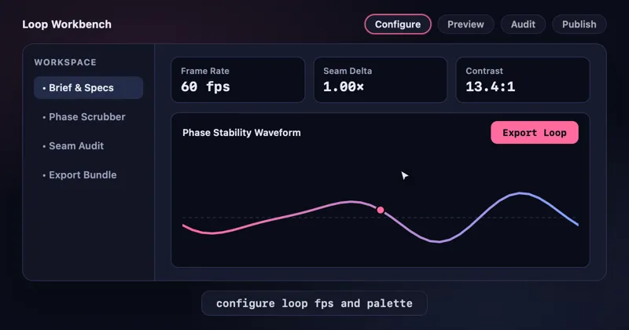
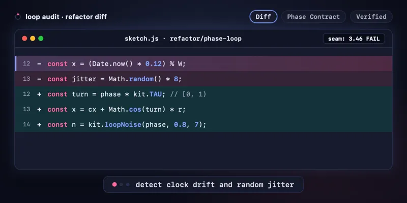

<p align="center">
  
</p>

<h1 align="center">Loop Studio</h1>

<p align="center">
  <strong>Deterministic HTML/WebGL2 browser capture, dual-theme dark/light README &amp; PR motion, and doc-drift auditing for coding agents.</strong>
</p>

<p align="center">
  <picture>
    <source media="(prefers-color-scheme: dark)" srcset="./assets/demos/ui-showcase-dark.webp">
    <source media="(prefers-color-scheme: light)" srcset="./assets/demos/ui-showcase-light.webp">
    
  </picture>
</p>

<p align="center">
  <em>Switch GitHub between Dark and Light mode to see the <code>&lt;picture&gt;</code> embed adapt automatically — rendered from plain HTML/CSS/SVG (<a href="./examples/ui-showcase"><code>examples/ui-showcase</code></a>), 240 frames @ 24 fps, <code>seamScore: 1.04</code>, <code>699 KB</code> dark / <code>752 KB</code> light.</em>
</p>

---

## Why Loop Studio?

GitHub READMEs and PR descriptions strip JavaScript, CSS animations, and Lottie embeds—only animated images (`WebP` / `GIF`) or uploaded `<video>` work. Existing alternatives each break down in predictable ways:

| Capability | **Loop Studio (`v2.0`)** | **Generative Video (Veo / Sora)** | **Remotion / Motion Canvas** | **Raw Playwright Screen Capture** |
| :--- | :--- | :--- | :--- | :--- |
| **Crisp code, CLI & UI typography** | **Real browser DOM + SVG + WebGL2** | Garbles code & UI labels | React DOM | Real browser DOM |
| **Zero `npm install` in non-JS repos** | **Yes** (single CLI, macOS WebKit / Chrome CDP) | API / cloud | Requires 300 MB+ React bundler | Requires Playwright + timing glue |
| **Frame-exact loop seam (`phase ∈ [0,1)`)** | **Frozen clocks + synchronous phase step** | Temporal flicker / jump | Manual frame math | Wall-clock jitter & dropped frames |
| **Dark + Light GitHub `<picture>` themes** | **1 flag (`--themes dark,light`)** + auto contrast | Single raster video | Manual duplicate setups | Manual dual recordings |
| **Verifies WCAG contrast, 400px width & doc drift** | **Built-in `loop audit` CI gate** | None | None | None |

---

## Where Loop Studio Shines

### 1. Dual-Theme PR Code Diffs & Migration Visuals

<p align="center">
  <picture>
    <source media="(prefers-color-scheme: dark)" srcset="./assets/demos/code-diff-dark.webp">
    <source media="(prefers-color-scheme: light)" srcset="./assets/demos/code-diff-light.webp">
    
  </picture>
</p>

Instead of recording a blurry QuickTime screencast for a PR or migration guide, author a single [`scene.html`](./examples/code-diff/scene.html) using `--loop-*` CSS variables and render both GitHub themes in one command:

```bash
node ./tool/bin/loop.js audit ./examples/code-diff --repo . --themes dark,light
node ./tool/bin/loop.js render ./examples/code-diff --themes dark,light --formats webp,png --max-kb 1024
```

Output: `854 KB` dark / `906 KB` light Animated WebP (`seamScore: 0.472`) plus a copy-paste `<picture>` block.

---

### 2. Source-Grounded Explainers That Catch Doc Drift

README diagrams silently rot when code changes. Every step in `showcase.json` cites a real repo-relative `file:line` range and optional `"match"` tokens checked within ±3 lines:

```json
{
  "from": 8.0,
  "to": 3.0,
  "caption": "detect clock drift and random jitter",
  "source": "tool/lib/harness.js:82-88",
  "match": ["FIXED_EPOCH", "Math.random"]
}
```

If someone refactors `FIXED_EPOCH` out of `tool/lib/harness.js`, `loop audit` fails CI immediately instead of shipping a lying README animation. Pair it with `loop story` + [`loop-cold-reader`](./agents/loop-cold-reader.md) (which inspects **only** `storyboard.png` with zero repo context) to verify a first-time visitor actually understands the animation.

---

### 3. Zero-Dependency WebGL2 Shaders & Interactive UI Walkthroughs

<table>
  <tr>
    <td width="340" align="center">
      
    </td>
    <td>
      <strong><code>examples/shader-hero</code> (WebGL2 GLSL · <code>761 KB</code> · <code>30 fps</code>)</strong><br><br>
      Drop any <code>shader.frag</code> using <code>uniform float u_phase</code> and Loop Studio compiles, steps <code>0..N-1</code> on the GPU via macOS WebKit or Headless Chrome, verifies <code>seamScore: 0.951</code>, and encodes crisp Animated WebP or 60 fps MP4—zero Vite, Three.js, or bundler setup.<br><br>
      <ul>
        <li><code>--loop-on-accent</code> &amp; <code>--loop-on-spark</code> automatically pick dark or light ink so CTA buttons stay WCAG <code>&gt;= 4.5:1</code> accessible in both themes.</li>
        <li><code>loop legible</code> probes real rendered DOM bounding boxes, <code>scrollWidth</code> overflow, and <code>400px</code> mobile legibility.</li>
      </ul>
    </td>
  </tr>
</table>

---

### 4. Universal CI Gate for External Videos (Remotion, Playwright, After Effects)

Already rendering animations in Remotion, Motion Canvas, or After Effects? Point `loop seam` or `loop audit` at **any** `.mp4`, `.gif`, `.webp`, or `.webm` (decoded via `ffmpeg` when installed):

```bash
node ./tool/bin/loop.js seam ./hero.mp4
node ./tool/bin/loop.js audit ./hero.webp --showcase ./showcase.json --repo . --max-kb 2048
```

- Detects broken wrap seams and duplicated end frames using lossy-codec RMS thresholds (`0.002` for MP4/WebP/WebM vs `0.0001` for lossless GIF).
- Enforces caption reading duration (`>= 0.5 + 0.3 * words` seconds), optional pixel `step.box` contrast checks, `--max-kb` payload budgets, and `file:line` + `"match"` source-drift checks (`0` pass, `1` fail, `2` missing `ffmpeg` or bad input).

---

## Install

Requires **Node.js 18+** (zero external npm packages; renders natively via macOS WebKit or Chrome/Chromium CDP; optional `ffmpeg` only for WebM export and external video auditing):

### Antigravity / Claude Code / Gemini CLI
```bash
# Antigravity (global plugin)
git clone https://github.com/MarcusK00/loop-studio.git ~/.gemini/config/plugins/loop-studio

# Claude Code
/plugin marketplace add Marcusk00/loop-studio
/plugin install loop-studio@loop-studio-marketplace

# Gemini CLI
gemini extensions install https://github.com/Marcusk00/loop-studio
```

### Standalone CLI
```bash
git clone https://github.com/MarcusK00/loop-studio.git
cd loop-studio
node ./tool/bin/loop.js doctor
npm test
```

---

## Quick Start

```bash
# 1. Scaffold an HTML/CSS/SVG starter (or --template code-diff | shader)
node ./tool/bin/loop.js new ./docs/demo --template code-diff

# 2. Generate storyboard.png for a zero-context cold read
node ./tool/bin/loop.js story ./docs/demo

# 3. Audit seam, dual-theme WCAG contrast, mobile 400px layout, and source drift
node ./tool/bin/loop.js audit ./docs/demo --repo . --themes dark,light

# 4. Export dark/light WebP + PNG poster + copy-paste <picture> README snippet
node ./tool/bin/loop.js render ./docs/demo --themes dark,light --formats webp,png --max-kb 2048
```

---

## Repository Layout

```text
loop-studio/
├─ AGENTS.md / CLAUDE.md       # Agent instructions & CLI routing
├─ rules/AGENTS.md             # Phase Contract & verification invariants
├─ agents/loop-cold-reader.md  # Zero-context storyboard evaluator subagent
├─ skills/
│  ├─ loop-studio/SKILL.md     # Dual-theme HTML/WebGL2 README & PR motion workflow
│  └─ loop-audit/SKILL.md      # Project & external video seam/contrast/drift audit
├─ examples/                   # Source-only examples (code-diff, ui-showcase, shader-hero)
├─ assets/demos/               # Dual-theme README WebP demos (<4 MB total)
├─ tool/
│  ├─ bin/loop.js              # `loop` CLI
│  ├─ lib/                     # harness, webkit/chromium backends, analyzers, encoders, server
│  ├─ scripts/                 # macOS WKWebView & AVFoundation Swift runners
│  ├─ templates/               # `loop new` starters (html, code-diff, shader)
│  └─ test/run-evals.js        # Core, negative-gate & browser integration test suite
└─ docs/                       # Phase contract, CLI manual, and renderer ADR
```

---

## CLI Reference (`loop`)

| Command | Description |
| :--- | :--- |
| `loop new <dir> [--template html\|code-diff\|shader]` | Scaffold `scene.html` or `shader.frag`, `showcase.json` or `brief.json`, and `index.html` |
| `loop sheet <dir> [--every 8] [--cols 4]` | Render every Nth frame into a numbered contact sheet (`sheet.png`) |
| `loop story <dir>` | Render Frame `0` + step midpoints into `storyboard.png` |
| `loop seam <dir\|video> [--lossy]` | Measure wrap-seam RMS delta, duplicate frames, and flicker on a project or external video |
| `loop legible <dir> [--themes dark,light]` | Verify stage labels, reading time, DOM overflow, `400px` sizing, and `4.5:1` WCAG contrast |
| `loop source-check <dir\|showcase.json> [--repo .]` | Verify repo-relative `file:line` citations and `"match"` doc-drift tokens |
| `loop audit <dir\|video> [--repo .] [--themes dark,light] [--max-kb <n>]` | Unified verification gate (`0` pass, `1` fail, `2` missing runtime / invalid input) |
| `loop render <dir> [--themes dark,light] [--formats webp,gif,mp4,webm,png] [--max-kb <n>]` | Export WebP, GIF, MP4, WebM, PNG, and GitHub `<picture>` embeds |
| `loop serve <dir> [--port 4173]` | Interactive browser workbench with phase scrubber, theme toggle, and `400px` mobile toggle |
| `loop doctor` | Inspect available browser engines and encoders/decoders |

---

## License

[MIT](./LICENSE) © [Marcusk00](https://github.com/Marcusk00)
