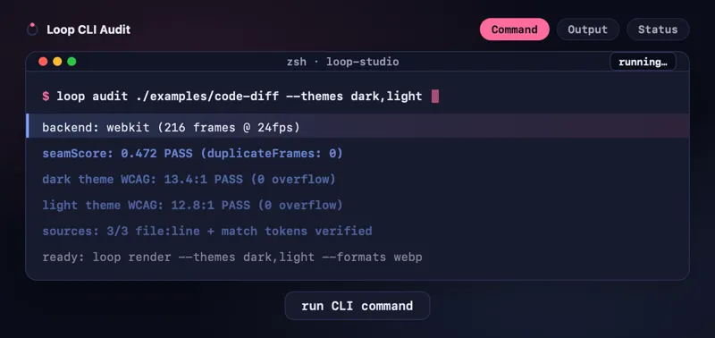
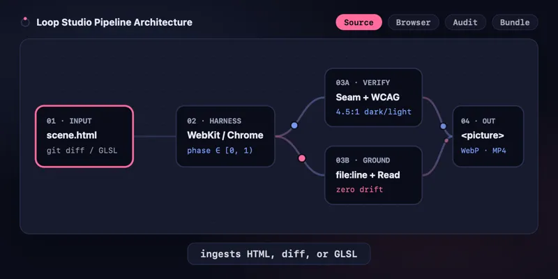
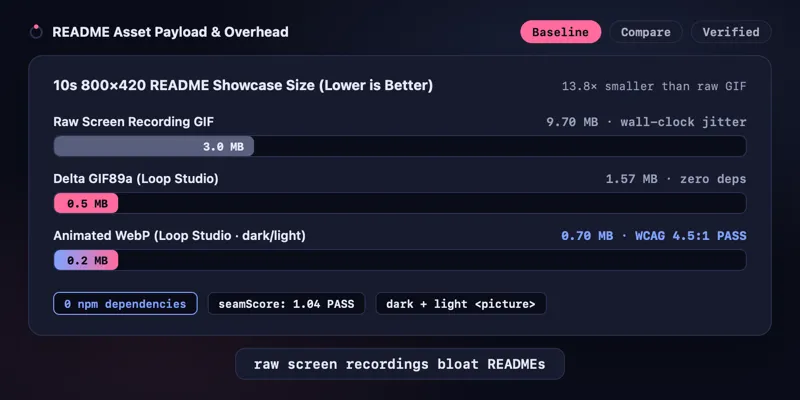
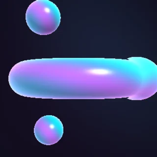

<p align="center">
  
</p>

<h1 align="center">Loop Studio</h1>

<p align="center">
  <strong>Turn real <code>git diff</code>s, CLI output, HTML/SVG diagrams, and WebGL2 shaders into verified, dual-theme dark/light README &amp; PR animations.</strong>
</p>

<p align="center">
  <picture>
    <source media="(prefers-color-scheme: dark)" srcset="./assets/demos/ui-showcase-dark.webp">
    <source media="(prefers-color-scheme: light)" srcset="./assets/demos/ui-showcase-light.webp">
    
  </picture>
</p>

<p align="center">
  <em>Switch GitHub between Dark and Light mode to watch every <code>&lt;picture&gt;</code> embed below adapt automatically — rendered from plain HTML/CSS/SVG (<a href="./examples/ui-showcase"><code>examples/ui-showcase</code></a>), 240 frames @ 24 fps, <code>seamScore: 1.04</code>, <code>699 KB</code> dark / <code>752 KB</code> light.</em>
</p>

---

## Why Loop Studio?

GitHub READMEs and PR descriptions strip JavaScript, CSS animations, and Lottie embeds—only animated images (`WebP` / `GIF`) or uploaded `<video>` work. Existing alternatives each break down in predictable ways:

| Capability | **Loop Studio (`v2.0`)** | **Generative Video (Veo / Sora)** | **Remotion / Motion Canvas** | **Raw Playwright / VHS Capture** |
| :--- | :--- | :--- | :--- | :--- |
| **Crisp code, CLI & UI typography** | **Real browser DOM + SVG + WebGL2** | Garbles code & UI labels | React DOM | Browser / terminal capture |
| **Generate directly from `git diff` or CLI cmd** | **`loop diff` & `loop term` (1 command)** | No | Manual React authoring | Manual tape / script |
| **Zero `npm install` in non-JS repos** | **Yes** (Node 18+ + macOS WebKit / Chrome CDP) | API / cloud | 300 MB+ React bundler | Go/ttyd/Playwright setup |
| **Frame-exact loop seam (`phase ∈ [0,1)`)** | **Frozen clocks + synchronous phase step** | Temporal flicker / jump | Manual frame math | Wall-clock jitter & dropped frames |
| **Dark + Light GitHub `<picture>` themes** | **1 flag (`--themes dark,light`)** + auto contrast | Single raster video | Duplicate setups | Single colorscheme |
| **Verifies WCAG contrast, 400px width & doc drift** | **Built-in `loop audit` CI gate** | None | None | None |

---

## Where Loop Studio Shines

### 1. Real `git diff` -> Dual-Theme PR Code Diffs (`loop diff`)

<p align="center">
  <picture>
    <source media="(prefers-color-scheme: dark)" srcset="./assets/demos/code-diff-dark.webp">
    <source media="(prefers-color-scheme: light)" srcset="./assets/demos/code-diff-light.webp">
    
  </picture>
</p>

Turn any branch diff, staged change, or `.patch` file into a syntax-highlighted, dark+light PR or migration visual—automatically grounded to the real changed `file:line` range and `"match"` symbol:

```bash
node ./tool/bin/loop.js diff ./pr-demo --range dev..HEAD
node ./tool/bin/loop.js audit ./pr-demo --repo . --themes dark,light
node ./tool/bin/loop.js render ./pr-demo --themes dark,light --formats webp,png --max-kb 1024
```

*Shown: [`examples/code-diff`](./examples/code-diff) · `854 KB` dark / `906 KB` light · `seamScore: 0.472`.*

---

### 2. Real CLI Output -> Dual-Theme Terminal Sessions (`loop term`)

<p align="center">
  <picture>
    <source media="(prefers-color-scheme: dark)" srcset="./assets/demos/cli-terminal-dark.webp">
    <source media="(prefers-color-scheme: light)" srcset="./assets/demos/cli-terminal-light.webp">
    
  </picture>
</p>

Capture real command stdout and exit status into a crisp dark/light terminal animation—no `ttyd`, Go runtime, or hand-recorded QuickTime screencasts:

```bash
node ./tool/bin/loop.js term ./cli-demo --cmd "npm test" --label "npm test"
node ./tool/bin/loop.js render ./cli-demo --themes dark,light --formats webp
```

*Shown: [`examples/cli-terminal`](./examples/cli-terminal) · `778 KB` dark / `863 KB` light · `seamScore: 0.472`.*

---

### 3. Animated SVG System Architecture & Dataflow Diagrams

<p align="center">
  <picture>
    <source media="(prefers-color-scheme: dark)" srcset="./assets/demos/architecture-flow-dark.webp">
    <source media="(prefers-color-scheme: light)" srcset="./assets/demos/architecture-flow-light.webp">
    
  </picture>
</p>

Replace static Mermaid boxes or broken dark-mode PNGs with animated SVG bezier topologies whose steps are tied directly to real implementation files via `file:line` + `"match"` checks:

*Shown: [`examples/architecture-flow`](./examples/architecture-flow) · `640 KB` dark / `688 KB` light · `seamScore: 1.073`, `flickerScore: 0.109`.*

---

### 4. Quantitative Benchmark & Payload Comparisons

<p align="center">
  <picture>
    <source media="(prefers-color-scheme: dark)" srcset="./assets/demos/benchmark-compare-dark.webp">
    <source media="(prefers-color-scheme: light)" srcset="./assets/demos/benchmark-compare-light.webp">
    
  </picture>
</p>

Ship clean, readable performance and bundle-size charts that animate smoothly across both GitHub themes and stay WCAG AA (`>= 4.5:1`) accessible at `400px` mobile width:

*Shown: [`examples/benchmark-compare`](./examples/benchmark-compare) · `529 KB` dark / `542 KB` light · `seamScore: 0.443`.*

---

### 5. Zero-Dependency WebGL2 Shaders

<table>
  <tr>
    <td width="340" align="center">
      
    </td>
    <td>
      <strong><a href="./examples/shader-hero"><code>examples/shader-hero</code></a> (WebGL2 GLSL · <code>761 KB</code> · <code>30 fps</code>)</strong><br><br>
      Drop any <code>shader.frag</code> using <code>uniform float u_phase</code> and Loop Studio compiles, steps <code>0..N-1</code> on the GPU via macOS WebKit or Headless Chrome, verifies <code>seamScore: 0.951</code>, and encodes Animated WebP or 60 fps MP4—zero Vite, Three.js, or bundler setup.<br><br>
      <ul>
        <li><code>--loop-on-accent</code> &amp; <code>--loop-on-spark</code> automatically pick dark or light ink so CTA buttons stay WCAG <code>&gt;= 4.5:1</code> in both themes.</li>
        <li><code>loop legible</code> probes real rendered DOM bounding boxes, <code>scrollWidth</code> overflow, and <code>400px</code> mobile legibility.</li>
      </ul>
    </td>
  </tr>
</table>

---

### 6. Source-Drift Detection & Universal External Video CI Gate

README visuals silently rot when code changes. Every step in `showcase.json` cites a repo-relative `file:line` range plus optional `"match"` tokens checked within ±3 lines:

```json
{
  "from": 8.0,
  "to": 3.0,
  "caption": "detect clock drift and random jitter",
  "source": "tool/lib/harness.js:82-88",
  "match": ["FIXED_EPOCH", "Math.random"]
}
```

If someone refactors `FIXED_EPOCH` out of `tool/lib/harness.js`, `loop audit` fails CI immediately. Pair with `loop story` + [`loop-cold-reader`](./agents/loop-cold-reader.md) (inspecting **only** `storyboard.png` with zero repo context) to verify a first-time visitor understands the diagram.

Already rendering videos in **Remotion, Motion Canvas, Playwright, or After Effects**? Point `loop seam` or `loop audit` at **any** `.mp4`, `.gif`, `.webp`, or `.webm` (decoded via `ffmpeg` when installed):

```bash
node ./tool/bin/loop.js seam ./hero.mp4
node ./tool/bin/loop.js audit ./hero.webp --showcase ./showcase.json --repo . --max-kb 2048
```

---

## Install

Requires **Node.js 18+** (zero external npm packages; renders natively via macOS WebKit or Chrome/Chromium CDP; optional `ffmpeg` only for WebM export and external video auditing):

### Antigravity / Claude Code / Gemini CLI
```bash
# Antigravity (global plugin)
git clone https://github.com/MarcusK00/loop-studio.git ~/.gemini/config/plugins/loop-studio

# Claude Code
/plugin marketplace add Marcusk00/loop-studio
/plugin install loop-studio@loop-studio-marketplace

# Gemini CLI
gemini extensions install https://github.com/Marcusk00/loop-studio
```

### Standalone CLI
```bash
git clone https://github.com/MarcusK00/loop-studio.git
cd loop-studio
node ./tool/bin/loop.js doctor
npm test
```

---

## Quick Start

```bash
# Generate from a real git diff, real CLI command, or clean HTML/GLSL starter
node ./tool/bin/loop.js diff ./docs/demo --range dev..HEAD
node ./tool/bin/loop.js term ./docs/demo --cmd "npm test" --label "npm test"
node ./tool/bin/loop.js new ./docs/demo --template html

# Build storyboard.png for a zero-context cold read
node ./tool/bin/loop.js story ./docs/demo

# Audit seam, dual-theme WCAG contrast, mobile 400px layout, and source drift
node ./tool/bin/loop.js audit ./docs/demo --repo . --themes dark,light

# Export dark/light WebP + PNG poster + copy-paste <picture> README snippet
node ./tool/bin/loop.js render ./docs/demo --themes dark,light --formats webp,png --max-kb 2048
```

---

## Repository Layout

```text
loop-studio/
├─ AGENTS.md / CLAUDE.md       # Agent instructions & CLI routing
├─ rules/AGENTS.md             # Phase Contract & verification invariants
├─ agents/loop-cold-reader.md  # Zero-context storyboard evaluator subagent
├─ skills/
│  ├─ loop-studio/SKILL.md     # Dual-theme HTML/WebGL2 README & PR motion workflow
│  └─ loop-audit/SKILL.md      # Project & external video seam/contrast/drift audit
├─ examples/                   # 6 source-only examples (ui-showcase, code-diff, cli-terminal, architecture-flow, benchmark-compare, shader-hero)
├─ assets/demos/               # Dual-theme README WebP demos
├─ tool/
│  ├─ bin/loop.js              # `loop` CLI
│  ├─ lib/                     # generators (diff/term), harness, webkit/chromium backends, analyzers, encoders, server
│  ├─ scripts/                 # macOS WKWebView & AVFoundation Swift runners
│  ├─ templates/               # `loop new` starters (html, code-diff, shader)
│  └─ test/run-evals.js        # Core, negative-gate & browser integration test suite
└─ docs/                       # Phase contract, CLI manual, and renderer ADR
```

---

## CLI Reference (`loop`)

| Command | Description |
| :--- | :--- |
| `loop diff <dir> [--range <a..b> \| --staged \| --file <patch>]` | Generate a dual-theme syntax-highlighted PR code-diff scene from real `git diff` output |
| `loop term <dir> --cmd "<command>" [--label "<text>"] [--output "<lines>"]` | Capture real CLI output into a dual-theme animated terminal showcase |
| `loop new <dir> [--template html\|code-diff\|shader]` | Scaffold `scene.html` or `shader.frag`, `showcase.json` or `brief.json`, and `index.html` |
| `loop sheet <dir> [--every 8] [--cols 4]` | Render every Nth frame into a numbered contact sheet (`sheet.png`) |
| `loop story <dir>` | Render Frame `0` + step midpoints into `storyboard.png` |
| `loop seam <dir\|video> [--lossy]` | Measure wrap-seam RMS delta, duplicate frames, and flicker on a project or external video |
| `loop legible <dir> [--themes dark,light]` | Verify stage labels, reading time, DOM overflow, `400px` sizing, and `4.5:1` WCAG contrast |
| `loop source-check <dir\|showcase.json> [--repo .]` | Verify repo-relative `file:line` citations and `"match"` doc-drift tokens |
| `loop audit <dir\|video> [--repo .] [--themes dark,light] [--max-kb <n>]` | Unified verification gate (`0` pass, `1` fail, `2` missing runtime / invalid input) |
| `loop render <dir> [--themes dark,light] [--formats webp,gif,mp4,webm,png] [--max-kb <n>]` | Export WebP, GIF, MP4, WebM, PNG, and GitHub `<picture>` embeds |
| `loop serve <dir> [--port 4173]` | Interactive browser workbench with phase scrubber, theme toggle, and `400px` mobile toggle |
| `loop doctor` | Inspect available browser engines and encoders/decoders |

---

## License

[MIT](./LICENSE) © [Marcusk00](https://github.com/Marcusk00)
