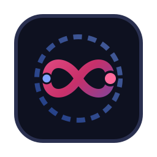
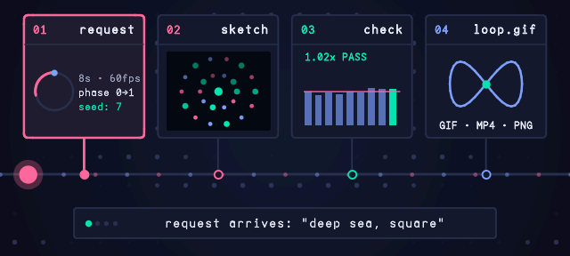
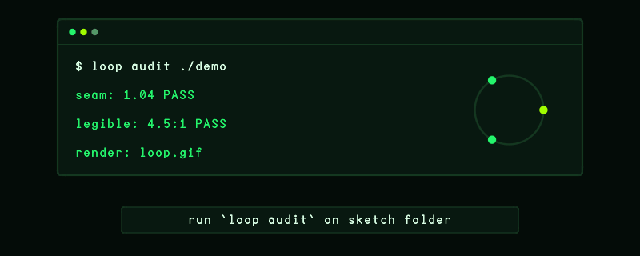
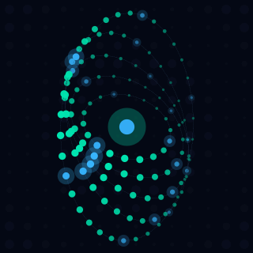
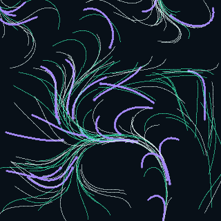
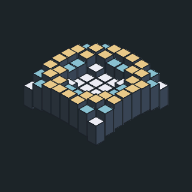
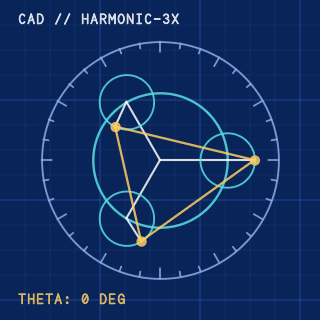

<p align="center">
  
</p>

<h1 align="center">Loop Studio</h1>

<p align="center">
  <strong>A universal multi-agent plugin &amp; deterministic CLI that makes coding agents produce verified, seamless animations and repository showcase loops.</strong>
</p>

<p align="center">
  
</p>

<p align="center">
  <em>Above: <code>gallery/loop-studio/showcase.gif</code> — a 10-second, 160-frame showcase loop rendered directly by the <code>loop</code> CLI (`seamScore: 1.00`, `duplicateFrames: 0`, `WCAG contrast: 13.7:1`).</em>
</p>

---

## Gallery

Every animation below is pure deterministic code (`sketch.js`), measured by `loop audit`, and committed with its exact `showcase.json` or `brief.json`, contact sheet (`sheet.png`), storyboard (`storyboard.png`), and `seam.json`. Pick any folder in [`gallery/`](./gallery), change one number, and re-render.

### Showcase Loops (What a Repository Does)

| Preview | Subject & Scene Pack | Seam & Audit | Artifacts |
| :--- | :--- | :--- | :--- |
|  | **Loop Studio Pipeline** (`scenes/flow` · `studio-dark`)<br><em>"Loop Studio turns a one-line request into a checked, seamless loop."</em> | `seamScore: 1.00`<br>`dups: 0` · `PASS` | [showcase.json](./gallery/loop-studio/showcase.json) · [sketch.js](./gallery/loop-studio/sketch.js) · [storyboard.png](./gallery/loop-studio/storyboard.png) · [audit.json](./gallery/loop-studio/audit.json) |
|  | **Loop CLI Audit Session** (`scenes/terminal` · `phosphor`)<br><em>"The loop CLI audits any sketch for seam jumps, caption legibility, and source citations."</em> | `seamScore: 1.02`<br>`dups: 0` · `PASS` | [showcase.json](./gallery/cli-audit-session/showcase.json) · [sketch.js](./gallery/cli-audit-session/sketch.js) · [storyboard.png](./gallery/cli-audit-session/storyboard.png) · [audit.json](./gallery/cli-audit-session/audit.json) |

### Ambient Loops (Mood, Backgrounds & Generative Motion)

| Preview | Style Pack & Prompt | Specs & Seam Score | Artifacts |
| :--- | :--- | :--- | :--- |
|  | **`styles/particle-orbit`** (`abyss`)<br><em>"Make a 4-second square loop. Deep sea, slow, bioluminescent."</em> | `4s · 20fps · 320×320`<br>`seamScore: 1.00` (`PASS`) | [brief.json](./gallery/deep-sea-orbits/brief.json) · [sketch.js](./gallery/deep-sea-orbits/sketch.js) · [sheet.png](./gallery/deep-sea-orbits/sheet.png) · [seam.json](./gallery/deep-sea-orbits/seam.json) |
|  | **`styles/flow-field`** (`aurora`)<br><em>"Drifting aurora currents, organic silk streamlines, 4-second loop."</em> | `4s · 20fps · 320×320`<br>`seamScore: 1.02` (`PASS`) | [brief.json](./gallery/aurora-flow-field/brief.json) · [sketch.js](./gallery/aurora-flow-field/sketch.js) · [sheet.png](./gallery/aurora-flow-field/sheet.png) · [seam.json](./gallery/aurora-flow-field/seam.json) |
|  | **`styles/isometric-grid`** (`nordic`)<br><em>"Clean architectural blocks on an isometric grid rising and falling in waves."</em> | `4s · 20fps · 320×320`<br>`seamScore: 1.00` (`PASS`) | [brief.json](./gallery/nordic-isometric/brief.json) · [sketch.js](./gallery/nordic-isometric/sketch.js) · [sheet.png](./gallery/nordic-isometric/sheet.png) · [seam.json](./gallery/nordic-isometric/seam.json) |
|  | **`styles/blueprint-cad`** (`blueprint`)<br><em>"Precision engineering blueprint with planetary gear linkages at 1x and -2x speeds."</em> | `4s · 20fps · 320×320`<br>`seamScore: 1.00` (`PASS`) | [brief.json](./gallery/cad-planetary/brief.json) · [sketch.js](./gallery/cad-planetary/sketch.js) · [sheet.png](./gallery/cad-planetary/sheet.png) · [seam.json](./gallery/cad-planetary/seam.json) |

---

## Install

Loop Studio ships as a **Universal Multi-Agent Plugin** supporting **Antigravity**, **Claude Code**, **Gemini CLI**, and any agent that reads `SKILL.md` and `AGENTS.md`, backed by a zero-dependency Node.js CLI (`loop`).

### 1. Antigravity

Install globally for all workspaces:

```bash
git clone https://github.com/Marcusk00/loop-studio.git ~/.gemini/config/plugins/loop-studio
```

Or add to a specific project workspace:

```bash
git clone https://github.com/Marcusk00/loop-studio.git .agents/plugins/loop-studio
```

### 2. Claude Code

```bash
/plugin marketplace add Marcusk00/loop-studio
/plugin install loop-studio@loop-studio-marketplace
```

### 3. Gemini CLI

```bash
gemini extensions install https://github.com/Marcusk00/loop-studio
```

### 4. Standalone CLI (`loop`)

Requires only **Node.js 18+** (zero external npm packages required; includes a built-in deterministic 2D software canvas, PNG encoder, and adaptive 256-color LZW GIF89a encoder, plus optional FFmpeg / Headless Chrome acceleration):

```bash
git clone https://github.com/Marcusk00/loop-studio.git
cd loop-studio
node ./tool/bin/loop.js doctor
npm test
```

---

## The One Rule: Everything Comes From `phase`

Coding agents can already write a canvas sketch. What they get wrong without help is the craft around it: making the last frame meet the first without a jump, composing visual hierarchy, keeping captions readable on phones, and verifying the output file.

Every sketch in Loop Studio meets a single mathematical contract:

```js
// sketch.js — the only contract a loop has to meet
export const meta = { seconds: 4, fps: 30, width: 1080, height: 1080, seed: 7, palette: "abyss" };

export function render(ctx, phase, kit) {
  // phase runs in [0, 1) where phase = frame / (meta.seconds * meta.fps)
  // phase = 1.0 is the exact same picture as phase = 0.0 and is NEVER rendered.
  const turn = phase * kit.TAU;
}
```

- **No clocks, no unseeded randomness**: `Date.now()` and `Math.random()` are forbidden. Every frame is a pure function of `(phase, meta, kit)`.
- **Frame `N` is never rendered**: A 120-frame loop renders frames `0..119` at `phase = f / 120`. Rendering frame `120` (`phase = 1.0`) duplicates frame `0` and causes a visible 1-frame stutter at the wrap point.
- **Whole cycles, circular noise, and overlapping generations**: Provided out-of-the-box by [`tool/lib/loop-kit.js`](./tool/lib/loop-kit.js) (`kit.sin`, `kit.loopNoise`, `kit.generations`, `kit.window`).

---

## Two Workflows: Showcase Loops & Ambient Loops

### 1. Showcase Loops ("Animate what this repo does")

Ask your agent:
> *"Make me a 10-second video that loops smoothly about this repo and what it does."*

The agent follows [`loop-showcase`](./skills/loop-showcase/SKILL.md):
1. **Reads the repo** (`README.md`, manifest, `examples/`, `tests/`) and states in one plain sentence what goes in, what happens to it, and what comes out.
2. **Writes `showcase.json`** with a stationary stage, wrap-point handover (`from: 8.5, to: 1.5`), and a mandatory `"source": "file:line"` citation for every step.
3. **Renders `storyboard.png`** (`loop story`) showing Frame `0` plus the midpoint of each step.
4. **Runs a Zero-Context Cold Read** ([`loop-cold-read`](./skills/loop-cold-read/SKILL.md)): hands *only* `storyboard.png` to the [`loop-cold-reader`](./agents/loop-cold-reader.md) subagent. If the unprimed subagent cannot tell what the project does, the diagram is revised.
5. **Runs `loop audit`**: verifies `seamScore <= 1.5`, `duplicateFrames === 0`, caption reading time `>= 0.5 + 0.3 * words`, WCAG AA contrast `>= 4.5:1`, mobile `400px` legibility, and `100%` valid `file:line` citations before rendering `showcase.gif` and `poster.png`.

### 2. Ambient Loops ("Make a 4-second deep sea bioluminescent loop")

Ask your agent:
> *"Make a 4-second square loop. Deep sea, slow, bioluminescent."*

The agent follows [`loop-studio`](./skills/loop-studio/SKILL.md):
1. Translates the mood into `brief.json` ([`loop-brief`](./skills/loop-brief/SKILL.md)) and loads the matching style pack ([`styles/particle-orbit`](./skills/styles/particle-orbit/SKILL.md)).
2. Writes `sketch.js` with three depth layers moving at integer harmonic ratios ([`loop-compose`](./skills/loop-compose/SKILL.md), [`loop-math`](./skills/loop-math/SKILL.md), [`loop-palette`](./skills/loop-palette/SKILL.md)).
3. Renders a numbered contact sheet (`loop sheet -> sheet.png`) and critiques focal point, speed contrast, and spatial balance ([`loop-critique`](./skills/loop-critique/SKILL.md)).
4. Measures the wrap seam (`loop seam -> seam.json`) and iterates for at most **3 rounds** before rendering `loop.gif` and `poster.png`.

---

## Repository Contents

```text
loop-studio/
├─ plugin.json                 # Antigravity plugin manifest
├─ .claude-plugin/             # Claude Code plugin & marketplace manifests
├─ gemini-extension.json       # Gemini CLI extension manifest
├─ AGENTS.md / CLAUDE.md       # Top-level agent instructions & command routing
├─ rules/
│  └─ AGENTS.md                # Always-on plugin invariants (Phase Contract & 3-Round Gate)
├─ agents/
│  ├─ loop-cold-reader.md      # Zero-context storyboard evaluator subagent
│  ├─ loop-critic.md           # Contact sheet & motion design critic subagent
│  └─ loop-choreographer.md    # Repo-to-showcase.json researcher subagent
├─ skills/
│  ├─ loop-studio/             # Entry skill & session orchestrator
│  ├─ loop-brief/              # Prompt -> brief.json specification generator
│  ├─ loop-math/               # Whole cycles, circular noise, overlapping generations
│  ├─ loop-compose/            # Focal anchor, 3-depth layers, easing, negative space
│  ├─ loop-palette/            # 12 semantic palettes, GIF quantization & Bayer dithering
│  ├─ loop-critique/           # Contact sheet diagnostic protocol & 3-round cap
│  ├─ loop-render/             # CLI execution & destination size budgets
│  ├─ loop-showcase/           # Repo reading protocol & sourced showcase.json authoring
│  ├─ loop-timeline/           # Stationary stage & wrap-point handover choreography
│  ├─ loop-type/               # Reading-time formula, WCAG 4.5:1 contrast & 400px phone rules
│  ├─ loop-cold-read/          # Fresh-agent storyboard comprehension test
│  ├─ loop-audit/              # Unified seam + legibility + source verification gate
│  ├─ loop-embed/              # Responsive dark/light <picture> & video README embeds
│  ├─ loop-new-style/          # Contributor guide for adding new style & scene packs
│  ├─ loop-scenes/             # Selector index for the 8 Showcase Scene Packs
│  ├─ loop-styles/             # Selector index for the 8 Ambient Style Packs
│  ├─ scenes/                  # 8 Showcase Scene Packs (SKILL.md + template.js)
│  │  ├─ flow/                 # Stage boxes on a horizontal transport rail
│  │  ├─ transform/            # Split before-and-after transformation core
│  │  ├─ terminal/             # Deterministic vector CLI session
│  │  ├─ code/                 # Stepping code snippet + live phase inspector
│  │  ├─ interface/            # Wireframe UI screen with closed-loop pointer
│  │  ├─ structure/            # Hierarchical tree / DAG signal propagation
│  │  ├─ architecture/         # Multi-tier system topology with request/response packets
│  │  └─ benchmark/            # Side-by-side quantitative seam / metric comparison
│  └─ styles/                  # 8 Ambient Style Packs (SKILL.md + template.js)
│     ├─ flow-field/           # Circular curl-noise streamlines across 3 generations
│     ├─ particle-orbit/       # Nested elliptical & bioluminescent harmonic orbits
│     ├─ sdf-raymarch/         # Software-safe 3D Signed Distance Field smooth union
│     ├─ kinetic-type/         # Harmonic wave typography poster
│     ├─ dither-mono/          # Ordered Bayer 4×4 / 8×8 retro CRT stippling
│     ├─ isometric-grid/       # Orthographic 3D blocks rising in harmonic waves
│     ├─ blueprint-cad/        # Technical CAD schematic with epicyclic gear linkages
│     └─ topographic-contour/  # Marching isolines over a cyclic 3D phase-noise field
├─ tool/                       # The `loop` CLI & deterministic rendering/analysis engine
│  ├─ bin/loop.js
│  ├─ lib/                     # loop-kit, soft-canvas, encoders, analyzers, compositor, server
│  ├─ scripts/build-gallery.js
│  └─ test/run-evals.js
├─ gallery/                    # 6 reproducible showcase & ambient loops with full artifacts
├─ evals/                      # Automated positive & negative verification gates
└─ docs/                       # Phase contract, CLI manual, and renderer ADR
```

---

## CLI Reference (`loop`)

| Command | Description | Writes |
| :--- | :--- | :--- |
| `loop new <dir> [--mode showcase\|ambient] [--scene <id>] [--style <id>] [--palette <id>]` | Scaffold a new loop folder from any scene or style template | `sketch.js`, `showcase.json` / `brief.json`, `index.html` |
| `loop sheet <dir> [--every 8] [--cols 4]` | Render every Nth frame into a numbered contact sheet | `sheet.png` |
| `loop story <dir>` | Render Frame `0` + midpoint of each showcase step for cold reading | `storyboard.png` |
| `loop seam <dir>` | Measure frame-to-frame RMS deltas, wrap seam score, duplicates, and flicker | `seam.json` |
| `loop legible <dir>` | Verify reading duration (`>= 0.5 + 0.3*words`), WCAG `4.5:1` contrast & phone margins | `legible.json` |
| `loop source-check <dir> [--repo <root>]` | Verify every `file:line` source citation in `showcase.json` exists | `sources.json` |
| `loop audit <dir> [--repo <root>]` | Run `seam`, `legible`, and `source-check` together as a single gate | `audit.json` |
| `loop render <dir> [--fps <n>] [--formats gif,mp4,webp,webm,png\|all]` | Render full-resolution `showcase.gif` / `loop.gif`, `poster.png`, `loop.mp4` (`30–120 fps` via FFmpeg or macOS AVFoundation), Animated `.webp`, and `.webm` | `loop.gif`, `loop.mp4`, `poster.png`, `seam.json` |
| `loop serve <dir> [--port 4173]` | Launch interactive browser workbench with phase scrubber & 400px phone view | `http://localhost:4173` |
| `loop doctor` | Check runtime engines (SoftCanvas2D, GIF89a, PNG, macOS AVFoundation, Animated WebP, FFmpeg, Chrome) | JSON diagnostic |

---

## License

[MIT](./LICENSE) © [Marcusk00](https://github.com/Marcusk00)
